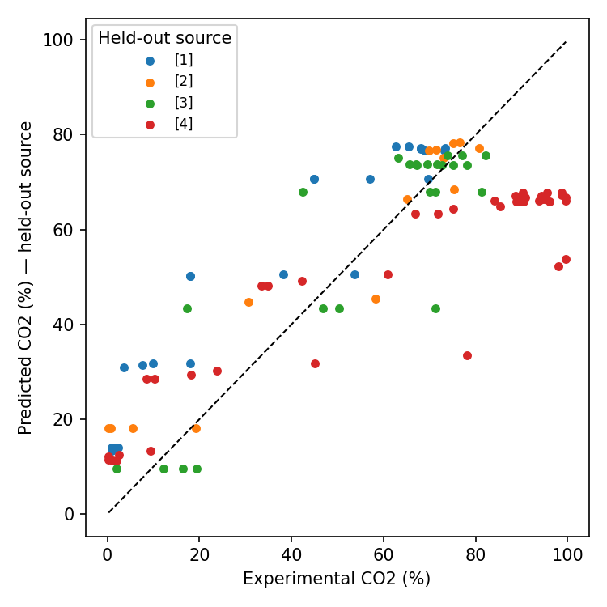
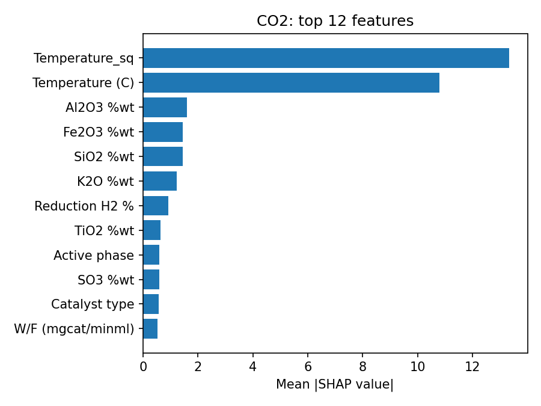

# Predicting catalyst performance from a small, heterogeneous literature dataset

End-to-end machine-learning workflow on tabular data: build a dataset by hand
from scientific articles, clean it, train gradient-boosted models, evaluate them
on sources they have never seen, and explain their predictions.

**Application domain:** CO₂ methanation (Sabatier reaction, CO₂ + 4 H₂ → CH₄ + 2 H₂O),
a candidate process for producing fuel from the Martian atmosphere (space ISRU).
The models predict **CO₂ conversion** and **CH₄ selectivity** of Ni catalysts from
support composition, preparation and operating conditions.

Master research project (MSR) at ICAM Strasbourg-Europe, with the ICube and
ICPEES laboratories (Sept. 2025 – Jan. 2026). Work presented at EHEC 2026 (Seville).

## Highlights

- **Dataset built from scratch:** 108 experiments (104 with both targets) extracted
  from 4 articles, 36 features. Released here with a reproducible cleaning script.
- **Data-quality audit:** found and fixed 112 cells that spreadsheet auto-formatting
  had turned into dates, 66 ratios typed as text, and 3 phantom category labels,
  all traced back to the source tables (`scripts/build_dataset.py`).
- **Honest validation:** Leave-One-Group-Out by article, with nested early stopping
  and model selection, so the held-out article is never used for any decision.
- **Interpretability:** TreeSHAP, Spearman correlations, pairwise oxide interactions.
- **Usable tool:** batch prediction from a spreadsheet and condition search by
  differential evolution.

## Results (LOGO-CV, 4 folds = 4 articles)

| Target | R² per fold (mean ± std) | R² pooled | MAE pooled |
|---|---|---|---|
| CO₂ conversion | **0.72 ± 0.13** | 0.69 | 14.7 pts |
| CH₄ selectivity | −2.21 ± 2.53 | −0.39 | 7.7 pts |

<p>


</p>

**What the numbers say**

- CO₂ conversion transfers to an unseen article (R² ≈ 0.7). Temperature and its
  square dominate; support oxides (Al₂O₃, Fe₂O₃, SiO₂, K₂O) come next.
- The model under-predicts the best catalysts of an unseen source: for article [4]
  it plateaus around 65 % where measurements reach 90–100 %. It ranks conditions
  better than it extrapolates to new performance levels.
- CH₄ selectivity does **not** generalise across articles. Most values lie between
  90 and 100 %, so within-article variance is tiny and R² is dominated by a
  per-article offset. MAE (~8 points) is the meaningful figure.
- With 4 sources, oxide composition is largely confounded with the source.
  SHAP results are leads for experiments, not causal effects.

Per-fold details: [`docs/logo_per_fold.csv`](docs/logo_per_fold.csv).
Modelling choices and limitations: [`docs/methodology.md`](docs/methodology.md).

## Quick start

```bash
python -m venv .venv && source .venv/bin/activate
pip install -e . pytest

python scripts/train.py --data data/catalyst_methanation_dataset.csv --out outputs/run
python scripts/predict.py --model outputs/run/model_bundle.joblib --input template.csv --write-template
# fill template.csv, then:
python scripts/predict.py --model outputs/run/model_bundle.joblib --input template.csv --out predictions.csv
python scripts/optimize.py --model outputs/run/model_bundle.joblib --config configs/optimize_example.json
pytest -q
```

`train.py` writes per-fold metrics, out-of-fold predictions, parity and SHAP plots,
correlation tables and a `model_bundle.joblib`.

## Repository layout

```
data/                 dataset (CSV), references, schema and corrections log
src/methanation_ml/   features, target transforms, LOGO validation, interpretability, prediction, optimisation
scripts/              build_dataset, train, predict, optimize, synthetic data for tests
configs/              example optimisation config
docs/                 methodology, figures, per-fold results
tests/                unit and end-to-end tests (on synthetic data)
```

## Stack

Python 3.11 · pandas · NumPy · scikit-learn · CatBoost · SciPy · Matplotlib · pytest

## Licence and citation

Code: MIT. Dataset compilation: CC BY 4.0. The underlying measurements come from
the four articles listed in [`data/references.csv`](data/references.csv); please
cite them if you reuse the data.
